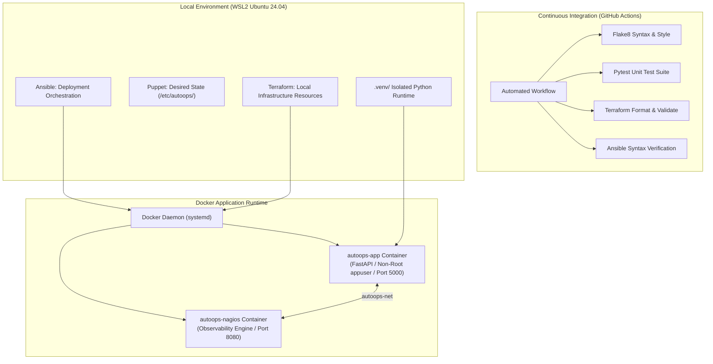

# AutoOps — CI/CD, Infrastructure as Code & Observability Platform

## 1. Project Overview & Objectives

**AutoOps** is an end-to-end, reproducible DevOps engineering platform designed to showcase automated application deployment, local Infrastructure as Code (IaC), configuration management, continuous integration, and observability. Built specifically for local reproducibility without incurring cloud costs, AutoOps demonstrates industry-standard practices across the complete DevOps lifecycle.

The primary objectives are:
- **Reproducible Containerized Application**: A production-conscious HTTP microservice written in Python using FastAPI, packaged as a lightweight, non-root, health-checked Docker container.
- **Local Infrastructure as Code**: Automated provisioning of local Docker infrastructure using Terraform with strict resource ownership boundaries.
- **Desired-State Configuration Management**: Idempotent configuration and policy enforcement using Puppet.
- **Orchestrated Deployments**: Automated deployment playbooks and operational procedures using Ansible.
- **Active Observability & Recovery**: Health verification, synthetic failure simulation, and automated recovery detection using Nagios.
- **Automated Validation**: CI pipeline enforcement using GitHub Actions.

---

## 2. Problem Statement

Modern software systems require coordinated automation across infrastructure provisioning, configuration management, application delivery, and monitoring. Disjointed tools frequently lead to state collisions (such as Terraform and Docker Compose competing for container ownership), security vulnerabilities (running containers as root), unhandled edge cases, and lack of verified observability during runtime failures. AutoOps resolves these challenges by defining clear operational responsibilities, isolated scopes for each tool, and evidence-backed verification.

---

## 3. Technology Stack

| Domain | Technology | Role in AutoOps | Version Constrained |
| :--- | :--- | :--- | :--- |
| **Operating System** | Ubuntu 24.04 via WSL2 | Host virtualization runtime with systemd | 24.04 LTS (Noble) |
| **Application Runtime** | Python / FastAPI / Uvicorn | Production-conscious HTTP microservice | Python 3.12, FastAPI 0.162+ |
| **Container Engine** | Docker & Docker Compose | Containerization and runtime service engine | Docker 29.1+, Compose 2.40+ |
| **Infrastructure as Code** | Terraform | Docker provider infrastructure resources | 1.9+ |
| **Config Management** | Puppet | Host-level desired-state configuration | 8.4+ |
| **Orchestration** | Ansible | Deployment playbooks and health checks | 9.2+ (core 2.16) |
| **Observability** | Nagios | Proactive synthetic monitoring and alerting | 4.x |
| **Version Control & CI** | Git & GitHub Actions | Repository hygiene and automated lint/test | Actions v4 |

---

## 4. Architecture & Component Ownership



### Resource Ownership Matrix

To prevent race conditions and conflicting state locks, resource boundaries are strictly partitioned:

| Resource | Owning Tool | Responsibility |
| :--- | :--- | :--- |
| **`autoops-app` Container** | Docker Compose / Ansible | Application execution, health check lifecycle, and rollout |
| **`autoops-nagios` Container** | Docker Compose | Synthetic monitoring service execution |
| **Host System Policies** | Puppet | `/etc/autoops/` configuration files, system-level desired state |
| **Auxiliary Infra Volumes & Nets** | Terraform | Isolated network definitions, persistent logging storage |

---

## 5. Repository Structure

```text
AutoOps/
├── app/
│   ├── __init__.py               # Package metadata and version definition
│   └── main.py                   # FastAPI microservice with /health and request logging
├── tests/
│   └── test_health.py            # Pytest test suite for health, contract, and routes
├── scripts/
│   ├── verify_app.sh             # Health check verification shell script
│   ├── test_local_server.sh      # Background server spawn and integration test script
│   └── test_docker_container.sh  # Docker container execution, health and user audit script
├── docs/
│   ├── architecture/             # Architecture diagrams and specifications
│   ├── evidence/                 # Verified command execution and test output logs
│   │   ├── pytest_results.txt
│   │   ├── local_http_tests.txt
│   │   ├── docker_build.txt
│   │   └── docker_container_verification.txt
│   └── report/                   # Academic report chapters and analysis
├── .dockerignore                 # Excludes caches, venv, git, and local tests from image
├── .gitignore                    # Excludes venv, pycache, tfstate, credentials, logs
├── Dockerfile                    # Pinned Python 3.12-slim non-root container image
├── Makefile                      # Standardized project tasks (build, test, lint, run)
├── pytest.ini                    # Pytest configuration and pythonpath discovery
├── requirements.txt              # Production runtime dependencies
├── requirements-dev.txt          # Development, testing, and linting dependencies
├── milestone-00-environment-and-architecture.md  # Milestone 00 diagnostic report
└── README.md                     # Comprehensive project documentation
```

---

## 6. Prerequisites

- **Host OS**: Ubuntu 24.04 LTS (native or running via WSL2 on Windows 11).
- **Python**: Version 3.12 or newer.
- **Docker Engine**: Docker 29.1+ with systemd and non-root group access (`docker.io`).
- **Make & Curl**: Required for developer workflows.

---

## 7. Setup & Installation

### Step 1: Clone Repository
```bash
git clone <repository-url> AutoOps
cd AutoOps
```

### Step 2: Create Virtual Environment & Install Dependencies
```bash
# Using Makefile
make install

# Or manually:
python3 -m venv .venv
source .venv/bin/activate
pip install --no-cache-dir -r requirements-dev.txt
```

---

## 8. Running the Application

### Local Development (Uvicorn)
```bash
# Using Makefile
make run

# Or directly:
source .venv/bin/activate
uvicorn app.main:app --host 0.0.0.0 --port 5000 --reload
```
Application will be available at: `http://localhost:5000`

### Running with Docker
```bash
# Build Docker image
make docker-build

# Run container in background on port 5000
make docker-run

# Verify container health
make docker-health

# Stop and remove container
make docker-stop
```

---

## 9. Health Endpoint & Contract

### Endpoint: `GET /health`
- **HTTP Status**: `200 OK`
- **Content-Type**: `application/json`

**Sample Response**:
```json
{
  "status": "healthy",
  "service": "autoops",
  "version": "0.1.0",
  "timestamp": "2026-10-28T07:44:46.903495+00:00",
  "uptime_seconds": 2.13
}
```

### Invalid Route Handling: `GET /api/v1/invalid-route`
- **HTTP Status**: `404 Not Found`
- **Content-Type**: `application/json`

**Sample Response**:
```json
{
  "error": "Not Found",
  "detail": "Not Found",
  "status_code": 404
}
```

---

## 10. Automated Testing & Verification

### Running Linting
```bash
make lint
# Or directly:
.venv/bin/flake8 app tests
```

### Running Pytest Unit Tests
```bash
make test
# Or directly:
.venv/bin/pytest -v tests
```

### Automated End-to-End Container Verification
```bash
./scripts/test_docker_container.sh
```

---

## 11. Milestone Status

| Milestone | Title | Status | Evidence Location |
| :--- | :--- | :--- | :--- |
| **Milestone 00** | Environment Verification & Architecture Lock | **COMPLETED** | `milestone-00-environment-and-architecture.md` |
| **Milestone 01** | Repository Setup & Application Microservice | **COMPLETED** | `docs/evidence/` |
| **Milestone 02** | Docker Compose & Terraform Local Infrastructure | *Upcoming* | `terraform/`, `compose.yaml` |
| **Milestone 03** | Puppet Configuration & Ansible Deployment | *Upcoming* | `puppet/`, `ansible/` |
| **Milestone 04** | Nagios Observability & Failure Recovery | *Upcoming* | `nagios/` |
| **Milestone 05** | Continuous Integration (GitHub Actions) | *Upcoming* | `.github/workflows/` |
| **Milestone 06** | Hardening, Project Report & Final Delivery | *Upcoming* | `docs/report/` |

---

## 12. Troubleshooting & Known Limitations

- **DrvFs I/O Speed**: When running inside WSL2 on Windows mounts (`/mnt/d/...`), initial directory operations may experience brief file synchronization latencies due to Windows filesystem translation.
- **Port 80 Conflict**: Port 80 on the host is occupied by an existing Apache service; AutoOps services intentionally bind to ports `5000` (application) and `8080` (monitoring) to avoid port contention.
- **CA Certificates in WSL**: If container pulls encounter TLS verification errors on corporate networks, run `sudo update-ca-certificates --fresh && sudo systemctl restart docker`.
