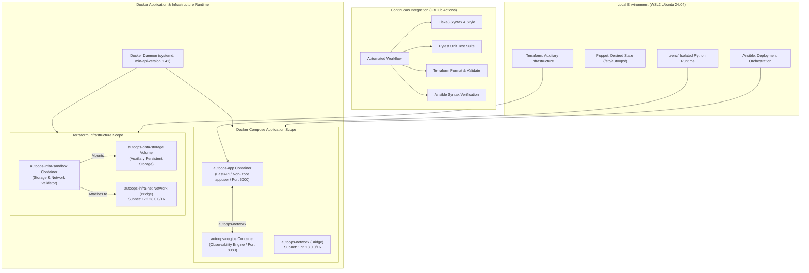

# AutoOps — CI/CD, Infrastructure as Code & Observability Platform

## 1. Project Overview & Objectives

**AutoOps** is an end-to-end, reproducible DevOps engineering platform designed to showcase automated application deployment, local Infrastructure as Code (IaC), configuration management, continuous integration, and observability. Built specifically for local reproducibility without incurring cloud costs, AutoOps demonstrates industry-standard practices across the complete DevOps lifecycle.

The primary objectives are:
- **Reproducible Containerized Application**: A production-conscious HTTP microservice written in Python using FastAPI, packaged as a lightweight, non-root, health-checked Docker container.
- **Docker Compose Service Orchestration**: Declarative runtime management for application and observability services via `compose.yaml`.
- **Local Infrastructure as Code**: Automated provisioning of local Docker infrastructure using Terraform with strict resource ownership boundaries.
- **Desired-State Configuration Management**: Idempotent configuration and policy enforcement using Puppet.
- **Orchestrated Deployments**: Automated deployment playbooks and operational procedures using Ansible.
- **Active Observability & Recovery**: Health verification, synthetic failure simulation, and automated recovery detection using Nagios.
- **Automated Validation**: CI pipeline enforcement using GitHub Actions.

---

## 2. Problem Statement

Modern software systems require coordinated automation across infrastructure provisioning, configuration management, application delivery, and monitoring. Disjointed tools frequently lead to state collisions (such as Terraform and Docker Compose competing for container ownership), security vulnerabilities (running containers as root), unhandled edge cases, and lack of verified observability during runtime failures. AutoOps resolves these challenges by defining clear operational responsibilities, isolated scopes for each tool, and evidence-backed verification.

---

## 3. Technology Stack

| Domain | Technology | Role in AutoOps | Version Constrained |
| :--- | :--- | :--- | :--- |
| **Operating System** | Ubuntu 24.04 via WSL2 | Host virtualization runtime with systemd | 24.04 LTS (Noble) |
| **Application Runtime** | Python / FastAPI / Uvicorn | Production-conscious HTTP microservice | Python 3.12, FastAPI 0.162+ |
| **Container Engine** | Docker & Docker Compose | Containerization and runtime service engine | Docker 29.1+, Compose 2.40+ |
| **Infrastructure as Code** | Terraform (`kreuzwerker/docker`) | Docker provider infrastructure resources | Terraform 1.9.8, Provider 3.0.2 |
| **Config Management** | Puppet | Host-level desired-state configuration | 8.4+ |
| **Orchestration** | Ansible | Deployment playbooks and health checks | 9.2+ (core 2.16) |
| **Observability** | Nagios Core | Proactive synthetic monitoring and alerting | 4.x |
| **Version Control & CI** | Git & GitHub Actions | Repository hygiene and automated lint/test | Actions v4 |

---

## 4. Architecture & Component Ownership



### Resource Ownership Matrix

To eliminate state collisions and conflicting lifecycle operations, ownership is strictly partitioned:

| Resource Identifier | Resource Type | Managing Tool | Manifest File | Purpose |
| :--- | :--- | :--- | :--- | :--- |
| **`autoops-app`** | Container | **Docker Compose** | `compose.yaml` | Application runtime exposing port 5000 |
| **`autoops-network`** | Docker Network | **Docker Compose** | `compose.yaml` | Dedicated bridge network (172.18.0.0/16) for app & monitoring |
| **`autoops-nagios`** | Container | **Docker Compose** | `compose.yaml` (M04) | Synthetic observability engine polling `/health` |
| **`autoops-infra-net`** | Docker Network | **Terraform** | `terraform/main.tf` | Isolated infrastructure audit network (172.28.0.0/16) |
| **`autoops-data-storage`** | Docker Volume | **Terraform** | `terraform/main.tf` | Auxiliary persistent volume for operational backups |
| **`autoops-infra-sandbox`**| Container | **Terraform** | `terraform/main.tf` | Ephemeral validator verifying storage write permissions |

---

## 5. Repository Structure

```text
AutoOps/
├── app/
│   ├── __init__.py               # Package metadata and version definition
│   └── main.py                   # FastAPI microservice with /health and request logging
├── tests/
│   └── test_health.py            # Pytest test suite for health, contract, and routes
├── terraform/
│   ├── versions.tf               # Terraform version & kreuzwerker/docker provider constraints
│   ├── main.tf                   # Docker network, volume, image, and sandbox container resources
│   ├── variables.tf              # Input variables for subnets, volume names, and environments
│   └── outputs.tf                # Infrastructure resource IDs, network subnets, and volume names
├── puppet/
│   ├── manifests/
│   │   └── site.pp               # Puppet top-level site manifest declaring policy
│   └── modules/
│       └── autoops_policy/       # AutoOps host policy configuration management module
│           ├── manifests/
│           │   └── init.pp       # Class declaration with directory and file resource enforcement
│           └── templates/
│               └── autoops_policy.conf.epp  # EPP template for /etc/autoops/autoops_policy.conf
├── ansible/
│   ├── ansible.cfg               # Ansible configuration with local connection and yaml callback
│   ├── inventory/
│   │   └── hosts.ini             # Localhost inventory definition
│   └── playbooks/
│       ├── 01_preflight.yml      # Docker daemon, compose, and policy readiness checks
│       ├── 02_deploy.yml         # Container build, rolling restart, and health wait loop
│       ├── 03_smoke_test.yml     # Microservice HTTP contract validation (/health, /, 404)
│       ├── 04_verify.yml         # Consolidated post-deployment architecture and drift audit
│       └── 99_error_handling.yml # Graceful error interception and rescue block validation
├── nagios/
│   ├── nagios.cfg                # Main Nagios Core config (interval_length=5, conf.d include)
│   ├── conf.d/
│   │   └── autoops.cfg           # Host autoops-app and HTTP /health, root, TCP services
│   └── .env.example              # Credentials template (NAGIOSADMIN_USER, NAGIOSADMIN_PASS)
├── scripts/
│   ├── verify_app.sh             # Health check verification shell script
│   ├── test_local_server.sh      # Background server spawn and integration test script
│   ├── test_docker_container.sh  # Docker container execution, health and user audit script
│   ├── test_compose.sh           # Docker Compose validation, startup, and health check runner
│   ├── test_puppet.sh            # Puppet syntax, dry-run, idempotency, and drift test runner
│   ├── test_ansible.sh           # Ansible playbook syntax and execution test runner
│   └── test_nagios.sh            # Nagios failure injection, detection and recovery runner
├── docs/
│   ├── architecture/             # Architecture specifications and design docs
│   │   ├── resource_ownership.md # Formal resource partition and separation matrix
│   │   └── nagios_monitoring_design.md # Nagios network topology and failure simulation design
│   ├── evidence/                 # Verified command execution and test output logs
│   │   ├── pytest_results.txt
│   │   ├── local_http_tests.txt
│   │   ├── docker_build.txt
│   │   ├── docker_container_verification.txt
│   │   ├── compose_verification.txt
│   │   ├── terraform_plan.txt
│   │   ├── terraform_apply.txt
│   │   ├── terraform_plan_idempotent.txt
│   │   ├── terraform_safe_destroy.txt
│   │   ├── puppet_verification.txt
│   │   ├── ansible_verification.txt
│   │   └── nagios_verification.txt
│   └── report/                   # Academic report chapters and analysis
├── .dockerignore                 # Excludes caches, venv, git, and local tests from image
├── .gitignore                    # Excludes venv, pycache, tfstate, credentials, logs
├── compose.yaml                  # Docker Compose orchestration definition
├── Dockerfile                    # Pinned Python 3.12-slim non-root container image
├── Makefile                      # Standardized project tasks (build, test, compose, terraform, puppet, ansible)
├── pytest.ini                    # Pytest configuration and pythonpath discovery
├── requirements.txt              # Production runtime dependencies
├── requirements-dev.txt          # Development, testing, and linting dependencies
├── milestone-00-environment-and-architecture.md  # Milestone 00 diagnostic report
└── README.md                     # Comprehensive project documentation
```

---

## 6. Setup & Installation

### Step 1: Clone Repository
```bash
git clone <repository-url> AutoOps
cd AutoOps
```

### Step 2: Install Virtual Environment & Dependencies
```bash
make install
```

---

## 7. Running & Orchestrating Services

### Docker Compose Orchestration (Application Runtime)
```bash
# Start runtime services in background
make compose-up

# View running services
make compose-ps

# Query application health check
make docker-health

# Tear down Compose services
make compose-down
```

### Terraform Infrastructure as Code (Auxiliary Infrastructure)
```bash
# Initialize Terraform provider
make tf-init

# Generate and inspect execution plan
make tf-plan

# Provision infrastructure resources
make tf-apply

# Safe infrastructure teardown
make tf-destroy
```

### Puppet Configuration Management (Host Desired-State Policy)
```bash
# Validate Puppet manifest and template syntax
make puppet-validate

# Lint Puppet code
make puppet-lint

# Apply desired-state policy locally (/etc/autoops/autoops_policy.conf)
make puppet-apply

# Run full Puppet verification test suite (dry-run, apply, idempotency, drift remediation)
make puppet-test
```

### Ansible Deployment Automation (Operational Orchestration)
```bash
# Validate playbook syntax
make ansible-syntax

# Execute preflight environment check
make ansible-preflight

# Deploy / rolling restart application container via Compose
make ansible-deploy

# Execute HTTP smoke test suite
make ansible-smoke

# Execute full post-deployment architecture audit
make ansible-verify

# Run complete end-to-end Ansible verification test suite
make ansible-test
```

### Nagios Observability & Monitoring
```bash
# Validate Nagios configuration syntax (pre-flight check)
make nagios-verify

# Check Nagios web dashboard availability on 127.0.0.1:8080
make nagios-dashboard

# Follow Nagios service logs
make nagios-logs

# Run end-to-end failure injection, detection, and recovery verification
make nagios-test
```

---

## 8. Automated Testing & Verification

### Code Quality & Unit Tests
```bash
make lint
make test
```

### End-to-End Test Suite Execution
```bash
# Standalone container test
./scripts/test_docker_container.sh

# Docker Compose integration test
./scripts/test_compose.sh

# Puppet configuration management test
./scripts/test_puppet.sh

# Ansible deployment and orchestration test
./scripts/test_ansible.sh

# Nagios monitoring and recovery test
./scripts/test_nagios.sh
```

---

## 9. Milestone Status

| Milestone | Title | Status | Evidence Location |
| :--- | :--- | :--- | :--- |
| **Milestone 00** | Environment Verification & Architecture Lock | **COMPLETED** | `milestone-00-environment-and-architecture.md` |
| **Milestone 01** | Repository Setup & Application Microservice | **COMPLETED** | `docs/evidence/` |
| **Milestone 02** | Docker Compose & Terraform Local Infrastructure | **COMPLETED** | `docs/evidence/` |
| **Milestone 03** | Puppet Configuration & Ansible Deployment | **COMPLETED** | `docs/evidence/puppet_verification.txt`, `docs/evidence/ansible_verification.txt` |
| **Milestone 04** | Nagios Observability & Failure Recovery | **COMPLETED** | `docs/evidence/nagios_verification.txt` |
| **Milestone 05** | Continuous Integration (GitHub Actions) | *Upcoming* | `.github/workflows/` |
| **Milestone 06** | Hardening, Project Report & Final Delivery | *Upcoming* | `docs/report/` |

---

## 10. Troubleshooting & Technical Notes

- **Docker Daemon API Compatibility**: Docker 29.x enforces a minimum API version of 1.44 by default. To maintain compatibility with the `kreuzwerker/docker` provider (which issues API 1.41 calls), `/etc/docker/daemon.json` is configured with `"min-api-version": "1.41"`.
- **Air-Gapped / Restricted Provider Installation**: In restricted enterprise or university networks blocking `release-assets.githubusercontent.com`, Terraform providers are served via a verified local filesystem mirror (`~/.terraformrc` pointing to `~/.terraform.d/plugins`) verified against official HashiCorp SHA-256 checksums.
- **Port 80 Avoidance**: The host Apache instance binds to port 80; AutoOps binds to port `5000` (application) and port `8080` (monitoring) to prevent bind conflicts.
- **Puppet Standalone Apply**: Puppet runs via `puppet apply` directly against local manifests (`puppet/manifests/site.pp`), ensuring completely reproducible desired-state configuration without requiring a heavy Puppet Server daemon.
- **Ansible DrvFs / World-Writable Permissions**: In WSL environments mounting Windows filesystems (`/mnt/d/...`), Ansible configuration requires `export ANSIBLE_CONFIG=ansible/ansible.cfg` to prevent DrvFs world-writable permission warnings from ignoring custom settings.
- **Nagios Granular Timing (`interval_length=5`)**: By default, Nagios checks evaluate on a 60-second timeunit. Configuring `interval_length=5` enables rapid 10-second checks and 5-second retries, allowing swift failure detection and recovery verification during demonstrations.
- **WSL Swap Allocation & Drive C Exhaustion**: When Windows Drive C free space falls critically low, WSL2 may fail to boot due to swap allocation failures (`CreateInstance/E_FAIL`). Disabling swap (`swap=0` in `.wslconfig`) and hosting the virtual disk on a high-capacity drive permanently prevents storage-induced crashes.
