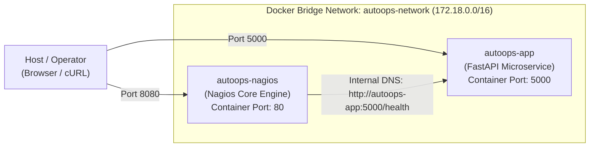

# AutoOps — Nagios Observability Architecture & Connectivity Design

## 1. Overview
In Milestone 04, the AutoOps platform integrates **Nagios Core** to provide synthetic service monitoring, failure detection, and automatic recovery observation.

---

## 2. Network Topology & Container Connectivity



---

## 3. Connectivity Specifications

| Parameter | Specification | Rationalization |
| :--- | :--- | :--- |
| **Container Name** | `autoops-nagios` | Deterministic hostname for Compose and Ansible |
| **Image Base** | `jasonrivers/nagios:latest` (Nagios Core 4.5.12) | Standard, reproducible community container with runit process management |
| **Shared Network** | `autoops-network` (172.18.0.0/16) | Docker embedded DNS resolves `autoops-app` directly |
| **Internal Target URL**| `http://autoops-app:5000/health` | Eliminates dependency on host port forwarding |
| **Host Port Mapping** | `127.0.0.1:8080:80` | Container port 80 maps to localhost 8080 only, protecting host port 80 |
| **Check Plugin** | `check_http` (standard Nagios plugin) | `check_http -I autoops-app -p 5000 -u /health -e "HTTP/1.1 200" -s "healthy"` |
| **Interval Base** | `interval_length=5` (5-second base timeunit) | Enables rapid detection without modifying Nagios compiled interval defaults |
| **Check Interval** | 2 timeunits (10 seconds) | Rapid polling for responsive viva demonstration |
| **Retry Interval** | 1 timeunit (5 seconds) | Rapid confirmation of service failure / recovery |
| **Max Check Attempts**| 2 attempts | Rapid HARD state transition (Soft: 5s, Hard: 10s) |

---

## 4. Nagios Engine Configuration Structure

The Nagios service is configured via local files mounted read-only into `/opt/nagios/etc/`:
- `nagios/nagios.cfg`: Master Nagios configuration defining `interval_length=5` and `cfg_dir=/opt/nagios/etc/conf.d`.
- `nagios/conf.d/autoops.cfg`: Object definitions containing:
  - **Host Definition**: `autoops-app` with check command `check_http_port_5000`.
  - **Service 1**: `AutoOps_Microservice_Health` probing `http://autoops-app:5000/health` verifying status `HTTP/1.1 200` and substring `"healthy"`.
  - **Service 2**: `AutoOps_Microservice_Root` probing `/` for API description string `"AutoOps API"`.
  - **Service 3**: `AutoOps_Microservice_Port_5000` executing `check_tcp!5000` to verify transport-level socket availability.
  - **Command Definitions**: Explicit check commands with parameter tokens.

---

## 5. Failure Simulation & Recovery Cycle

```mermaid
sequenceDiagram
    autonumber
    participant App as autoops-app (:5000)
    participant Nagios as autoops-nagios (:8080)
    participant Log as /opt/nagios/var/nagios.log

    Note over App,Nagios: Normal Operation (State: OK / 0)
    Nagios->>App: GET /health (check_http)
    App-->>Nagios: 200 OK ("status":"healthy")
    Nagios->>Log: SERVICE ALERT: autoops-app;AutoOps_Microservice_Health;OK;HARD;1

    Note over App: Controlled Failure Injected (docker stop autoops-app)
    Nagios->>App: GET /health (Attempt 1)
    App--xNagios: Connection refused / DNS resolution failure
    Nagios->>Log: SERVICE ALERT: autoops-app;AutoOps_Microservice_Health;CRITICAL;SOFT;1
    Nagios->>App: GET /health (Attempt 2 - Retry after 5s)
    App--xNagios: Connection refused / DNS resolution failure
    Nagios->>Log: SERVICE ALERT: autoops-app;AutoOps_Microservice_Health;CRITICAL;HARD;2

    Note over App: Service Restored (docker start autoops-app)
    Nagios->>App: GET /health (Next Check Cycle)
    App-->>Nagios: 200 OK ("status":"healthy")
    Nagios->>Log: SERVICE ALERT: autoops-app;AutoOps_Microservice_Health;OK;HARD;1
```

### Verified Log Transitions (Evidence Excerpt)
```text
[1793188215] SERVICE ALERT: autoops-app;AutoOps_Microservice_Health;CRITICAL;SOFT;1;Temporary failure in name resolution
[1793188220] SERVICE ALERT: autoops-app;AutoOps_Microservice_Health;CRITICAL;HARD;2;Temporary failure in name resolution
[1793188230] SERVICE ALERT: autoops-app;AutoOps_Microservice_Health;OK;HARD;1;HTTP OK: Status line output matched "HTTP/1.1 200" - 272 bytes in 0.005 second response time
```
