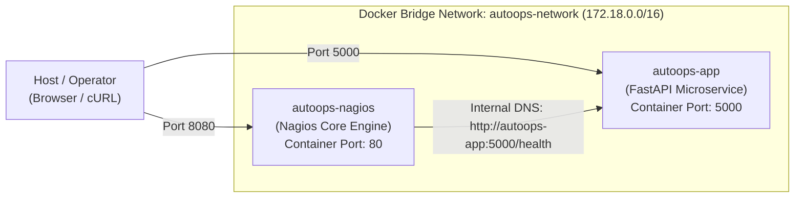

# AutoOps — Nagios Observability Architecture & Connectivity Design

## 1. Overview
In Milestone 04, the AutoOps platform integrates **Nagios Core** to provide synthetic service monitoring, failure detection, and automatic recovery observation.

---

## 2. Network Topology & Container Connectivity

---

## 3. Connectivity Specifications

| Parameter | Specification | Rationalization |
| :--- | :--- | :--- |
| **Container Name** | `autoops-nagios` | Deterministic hostname for Compose and Ansible |
| **Shared Network** | `autoops-network` | Docker embedded DNS resolves `autoops-app` directly |
| **Internal Target URL**| `http://autoops-app:5000/health` | Eliminates dependency on host port forwarding |
| **Host Port Mapping** | `8080:80` | Container port 80 maps to host 8080, bypassing host port 80 (Apache) |
| **Check Plugin** | `check_http` (standard Nagios plugin) | `check_http -H autoops-app -p 5000 -u /health -e "HTTP/1.1 200 OK"` |
| **Check Interval** | 15 seconds (Normal), 5 seconds (Retry) | Rapid detection for local demonstration and viva evaluation |
| **Max Check Attempts**| 3 attempts | Prevents transient network false positives |

---

## 4. Failure Simulation & Recovery Cycle

1. **Normal Operation (OK)**:
   - Nagios queries `http://autoops-app:5000/health`.
   - Returns HTTP 200 with JSON contract `{"status": "healthy", ...}`.
   - Nagios state: `OK (Soft -> Hard)`.
2. **Controlled Failure Injection (CRITICAL)**:
   - Application container is paused (`docker pause autoops-app`) or stopped (`docker stop autoops-app`).
   - `check_http` connection times out or connection refused.
   - Nagios state transitions: `OK` -> `WARNING` -> `CRITICAL`.
3. **Recovery Verification (OK)**:
   - Application container is unpaused (`docker unpause autoops-app`) or restarted.
   - Next poll receives HTTP 200 OK.
   - Nagios state recovers to `OK` and logs recovery event timestamp.
