# AutoOps: CI/CD, Infrastructure as Code & Observability Platform
### Final Engineering & Academic Project Report

**Author / Lead Engineer**: Sharique  
**Submission Date**: October 2026  
**Target Environment**: Ubuntu 24.04 LTS (WSL2) on Local Workstation  
**Project Repository**: `AutoOps`  

---

## Abstract

Modern software engineering demands unified automation across the entire system lifecycle—spanning application runtime containerization, declarative Infrastructure as Code (IaC), desired-state configuration management, automated deployment orchestration, continuous integration, and proactive observability. In local development and resource-constrained environments, integrating disparate DevOps tools frequently results in race conditions, state collisions, credential leakage, and operational conflicts.

This project presents **AutoOps**, a fully reproducible, local-first DevOps platform engineered to solve these challenges without incurring cloud infrastructure costs. AutoOps integrates a containerized Python FastAPI microservice, Docker Compose runtime orchestration, Terraform-managed auxiliary Docker infrastructure, Puppet host policy enforcement, Ansible deployment automation, Nagios Core synthetic monitoring, and GitHub Actions automated quality gates. Through strict architectural resource partitioning, non-root container hardening, capability dropping, immutable root filesystems, and comprehensive multi-tiered verification, AutoOps provides an evidence-backed, production-conscious reference architecture suitable for academic evaluation, viva demonstration, and professional implementation.

**Keywords**: DevOps, Infrastructure as Code, Terraform, Docker Compose, Puppet, Ansible, Nagios Core, Continuous Integration, GitHub Actions, FastAPI, Container Hardening.

---

## 1. Introduction & Problem Statement

### 1.1 Motivation & Context
Software delivery pipelines increasingly rely on heterogeneous tools to provision infrastructure, enforce configuration compliance, deploy microservices, and detect runtime anomalies. However, standard academic and open-source demonstrations often suffer from key structural defects:
1. **Tool Overlap & State Collisions**: Docker Compose and Terraform frequently compete to manage identical container and network lifecycles, leading to race conditions and destroyed state.
2. **Security Anti-Patterns**: Containers run as root, filesystems remain writable, and sensitive passwords or tokens are checked into version control.
3. **Flawed Observability**: Monitoring configurations merely check raw TCP socket connectivity rather than validating semantic HTTP contracts and fail to observe automated recovery.
4. **Cloud Cost Barriers**: Many enterprise DevOps references mandate proprietary, paid cloud services (AWS, GCP, Azure), rendering them costly or irreproducible in academic settings.

### 1.2 Project Objectives
AutoOps was engineered to address these challenges with the following explicit objectives:
- **Zero Cloud Spend**: 100% reproducible on a local workstation using Ubuntu 24.04 LTS under WSL2.
- **Strict Boundary Separation**: Formal partitioning where Docker Compose, Terraform, Puppet, and Ansible operate in disjoint, documented operational spheres.
- **Enterprise-Grade Hardening**: Complete elimination of root container processes, immutable filesystems (`read_only: true`), Linux capability stripping (`cap_drop: [ALL]`), and loopback-only administrative interfaces (`127.0.0.1:8080`).
- **Semantic Observability**: Nagios Core synthetic health probes validating HTTP status codes, JSON payload schemas, and automatic recovery detection.
- **Automated Quality Gates**: CI pipeline enforcing static analysis, linting, unit testing, schema validation, and secret scanning prior to deployment.

---

## 2. Requirements Specification

### 2.1 Functional Requirements
- **FR-01 (Application Microservice)**: Expose a production-ready HTTP microservice providing `GET /health` with structured JSON telemetry (`status`, `service`, `version`, `timestamp`, `uptime_seconds`) and `GET /` service metadata.
- **FR-02 (Runtime Orchestration)**: Orchestrate application and monitoring containers via Docker Compose with deterministic networking and automated health waiting conditions.
- **FR-03 (Infrastructure Provisioning)**: Provision isolated auxiliary networks, persistent backup storage volumes, and ephemeral validation testbeds via Terraform.
- **FR-04 (Configuration Management)**: Enforce desired system-level operational policies (`/etc/autoops/autoops_policy.conf`) via Puppet with automatic drift detection and remediation.
- **FR-05 (Deployment Automation)**: Execute automated preflight environment checks, image builds, rolling container recreation, smoke testing, and architecture auditing via Ansible playbooks.
- **FR-06 (Proactive Monitoring)**: Implement Nagios Core to continuously monitor microservice health, detect simulated container failures, and observe automatic recovery.
- **FR-07 (Continuous Integration)**: Implement a GitHub Actions workflow validating code formatting, unit tests, IaC schemas, playbook syntax, and repository hygiene.

### 2.2 Non-Functional Requirements
- **NFR-01 (Security & Least Privilege)**: Containers must execute under non-root user accounts, drop kernel capabilities, and prohibit privilege escalation (`no-new-privileges: true`).
- **NFR-02 (Port Collision Avoidance)**: Preserve existing host services (specifically system Apache on port 80); bind application to port 5000 and Nagios dashboard strictly to `127.0.0.1:8080`.
- **NFR-03 (Secret Hygiene)**: Zero secrets, tokens, or private keys committed to version control; automated CI secret scanner.
- **NFR-04 (Idempotency)**: Re-executing Terraform, Puppet, or Ansible on an unchanged system must produce zero drift and zero unauthorized modifications.

---

## 3. System Architecture & Resource Ownership

### 3.1 Architectural Topology

```mermaid
flowchart TD
    subgraph CI ["Continuous Integration Pipeline (GitHub Actions ci.yml)"]
        direction TB
        G1["Gate 1: Secret Scanning & Hygiene"]
        G2["Gate 2: Python Bytecode, Flake8 & Pytest"]
        G3["Gate 3: Terraform fmt & validate"]
        G4["Gate 4: Ansible Playbook Syntax Checks"]
        G5["Gate 5: Puppet Manifest & EPP Lint"]
        G6["Gate 6: Nagios Core Pre-Flight Check"]
    end

    subgraph Host ["Local Virtualization Host (Ubuntu 24.04 LTS / WSL2)"]
        APACHE["System Apache2 Server\n(Listening on *:80 - Preserved & Untouched)"]
        PUPPET["Puppet Policy Engine\n(/etc/autoops/autoops_policy.conf)"]
        ANSIBLE["Ansible Orchestrator\n(Playbooks 01-04 & 99)"]
        TF["Terraform Engine\n(State: terraform.tfstate)"]
    end

    subgraph DockerDaemon ["Docker Engine (API 1.41+ Compatible)"]
        subgraph ComposeScope ["Docker Compose Runtime Domain (compose.yaml)"]
            APP["autoops-app Container\n• Non-root appuser (10001)\n• Read-only rootfs\n• Capabilities dropped\n• Memory: 512MB | Port: 5000"]
            NAGIOS["autoops-nagios Container\n• Nagios Core 4.5.12\n• Memory: 1024MB\n• Port: 127.0.0.1:8080 (Loopback)"]
            NET_APP["autoops-network Bridge\nSubnet: 172.18.0.0/16"]

            APP <-->|Internal DNS http://autoops-app:5000/health| NAGIOS
            APP --- NET_APP
            NAGIOS --- NET_APP
        end

        subgraph TFScope ["Terraform Infrastructure Domain (terraform/main.tf)"]
            NET_INFRA["autoops-infra-net Bridge\nSubnet: 172.28.0.0/16"]
            VOL_DATA["autoops-data-storage Volume\n(Auxiliary Backup Storage)"]
            SANDBOX["autoops-infra-sandbox Container\n(python:3.12-slim / Ephemeral Validator)"]

            SANDBOX -->|Attaches to| NET_INFRA
            SANDBOX -->|Mounts| VOL_DATA
        end
    end

    PUPPET -.->|Enforces Host Policy| Host
    ANSIBLE -->|Deploys & Smoke Tests| ComposeScope
    ANSIBLE -->|Audits Isolation| TFScope
    TF -->|Manages Lifecycle| TFScope
```



### 3.2 Resource Ownership Matrix

To eliminate state collision and accidental destruction, resource responsibilities are partitioned strictly:

| Resource Identifier | Resource Type | Managing Tool | Manifest Source | Architectural Role |
| :--- | :--- | :--- | :--- | :--- |
| **`autoops-app`** | Container | **Docker Compose** | `compose.yaml` | Application runtime microservice exposing port 5000 |
| **`autoops-network`** | Docker Network | **Docker Compose** | `compose.yaml` | Dedicated bridge network (`172.18.0.0/16`) for application & monitoring |
| **`autoops-nagios`** | Container | **Docker Compose** | `compose.yaml` | Synthetic observability engine polling `/health` on `127.0.0.1:8080` |
| **`autoops-infra-net`** | Docker Network | **Terraform** | `terraform/main.tf` | Isolated infrastructure audit network (`172.28.0.0/16`) |
| **`autoops-data-storage`**| Docker Volume | **Terraform** | `terraform/main.tf` | Persistent auxiliary storage for operational infrastructure |
| **`autoops-infra-sandbox`**| Container | **Terraform** | `terraform/main.tf` | Ephemeral validator verifying storage write permissions |
| **`/etc/autoops/autoops_policy.conf`** | Configuration File | **Puppet** | `puppet/manifests/site.pp` | System-wide desired-state operational policy |
| **Operational Orchestration**| Playbooks | **Ansible** | `ansible/playbooks/*.yml` | Procedural preflight, deployment, smoke testing, and auditing |

---

## 4. Implementation Details & Technical Decisions

### 4.1 Application Microservice (`app/main.py`)
Developed using Python 3.12 and FastAPI, the service provides high-performance asynchronous HTTP endpoints.
- **Contract Enforcement**: Returns an RFC-compliant ISO 8601 UTC timestamp and dynamic uptime tracking calculated from process initialization.
- **Non-Root Packaging**: Built from `python:3.12-slim`. Generates user `appuser` (UID 10001, GID 10001) and drops all superuser privileges before runtime.
- **Self-Contained Health Check**: Utilizes Python's standard library `urllib.request` for container health probes, eliminating the need to install `curl` inside the production image.

### 4.2 Infrastructure as Code (`terraform/`)
Provisioned via Terraform v1.9.8 using the `kreuzwerker/docker` provider (~> 3.0.2).
- **API Version Negotiation**: Docker 29.x enforces API 1.44+ by default; to maintain compatibility with provider calls, `/etc/docker/daemon.json` was configured with `"min-api-version": "1.41"`.
- **Validation Testbed**: Automatically spins up `autoops-infra-sandbox` to assert volume write permissions and network attachment under Terraform state management without interfering with runtime microservice traffic.

### 4.3 Desired-State Policy Enforcement (`puppet/`)
Implemented via Puppet 8.4 in standalone apply mode (`puppet apply`), avoiding the resource overhead of a persistent Puppet Master daemon.
- **Parameterized Classes & Templates**: Employs an EPP template (`autoops_policy.conf.epp`) specifying runtime ports (5000, 8080), health check thresholds, and boundary allocations.
- **Idempotency & Drift Remediation**: Automatically detects manual configuration tampering and restores canonical policy values within 0.17 seconds.

### 4.4 Deployment Orchestration (`ansible/`)
Structured as a modular suite of 5 procedural playbooks executed with `ansible-core 2.16.3`:
1. `01_preflight.yml`: Verifies Docker daemon reachability, Compose CLI version, and Puppet policy presence.
2. `02_deploy.yml`: Rebuilds the microservice image and executes a rolling container restart via Compose.
3. `03_smoke_test.yml`: Executes black-box HTTP contract validation against `/health`, `/`, and handles 404 route errors.
4. `04_verify.yml`: Conducts a cross-tool architecture audit, verifying that networks, volumes, and states remain intact.
5. `99_error_handling.yml`: Demonstrates graceful failure interception using Ansible `block/rescue` structures.

### 4.5 Observability & Failure Detection (`nagios/`)
Containerized via `jasonrivers/nagios:latest` (Nagios Core 4.5.12).
- **Granular Scheduling Engine**: Customized `nagios.cfg` with `interval_length=5` (5-second base timeunit), enabling rapid 10-second check cycles and 5-second retries for responsive testing and demonstration.
- **Semantic Health Probing**: Service `AutoOps_Microservice_Health` executes `check_http` validating both `HTTP/1.1 200` status and `"healthy"` substring contract against `http://autoops-app:5000/health`.
- **End-to-End Failure & Recovery Cycle**: Demonstrated by stopping `autoops-app`, observing Nagios evaluate and alert state `CRITICAL (state code 2)`, restarting `autoops-app`, and recording automatic transition back to `OK (state code 0)`.

### 4.6 Continuous Integration Pipeline (`.github/workflows/ci.yml`)
Configured with minimal least-privilege permissions (`contents: read`) and triggered on `push`, `pull_request`, and `workflow_dispatch`.
- **Quality Gates**: Executes 6 parallel jobs: Secret Scanning & Hygiene, Python Quality (Flake8 & Pytest), Terraform Validation (`fmt` and `validate`), Ansible Syntax Verification, Puppet Manifest Linting, and Nagios Pre-Flight Configuration.
- **Boundary Separation**: CI validates syntax and schemas non-destructively; host-mutating Puppet applies and live container restarts are strictly partitioned to local integration execution.

---

## 5. Security & Risk Assessment

### 5.1 Container Hardening Implementation
- **Read-Only Root Filesystem**: `autoops-app` runs with `read_only: true`. Any attempt by an unauthorized process to write or modify binaries on the container root filesystem is rejected by the Linux kernel.
- **In-Memory Temporary Storage**: Writable scratch space is restricted to a RAM-backed `/tmp` mount (`tmpfs:rw,noexec,nosuid,size=64m`), preventing arbitrary binary execution.
- **Capability Dropping**: Stripped all Linux capabilities via `cap_drop: [ALL]`.
- **Privilege Hardening**: Enforced `security_opt: [no-new-privileges:true]`.
- **Resource Constraints**: Capped container resources to `mem_limit: 512m` / `cpus: 1.0` (application) and `mem_limit: 1024m` / `cpus: 1.5` (Nagios).

### 5.2 Secret Remediation & Continuous Hygiene
- **Historical Assessment**: A local test password (`[REDACTED_LOCAL_TEST_PASS]`) utilized during Milestone 04 container evaluation was documented as appearing in commit `0d89282`. In adherence to operational rules against rewriting Git history, the history was preserved intact.
- **Active Credential Rotation**: The active dashboard password was rotated to an uncommitted secret in `.env`.
- **Template Sanitization**: All tracked example files (`.env.example` and `nagios/.env.example`) feature generic placeholders (`ChangeMeToAStrongPassword123!`).
- **Automated Secret Scanner**: [`scripts/check_secrets.sh`](file:///D:/files/OneDrive/Desktop/AutoOps/scripts/check_secrets.sh) actively scans tracked files for private keys, AWS tokens, GitHub PATs, and rotated credentials, failing CI if violations occur.

---

## 6. Verification Results & Acceptance Matrix

Comprehensive testing across all project milestones confirmed the following results:

| Ref | Domain | Verification Command | Outcome | Evidence Path |
| :---: | :--- | :--- | :---: | :--- |
| **VR-01** | Unit Testing | `pytest -v tests` | **PASS (12/12 passed)** | [`docs/evidence/pytest_results.txt`](file:///D:/files/OneDrive/Desktop/AutoOps/docs/evidence/pytest_results.txt) |
| **VR-02** | Code Quality | `flake8 app tests scripts` | **PASS (0 violations)** | [`docs/evidence/ci_verification.txt`](file:///D:/files/OneDrive/Desktop/AutoOps/docs/evidence/ci_verification.txt) |
| **VR-03** | IaC Formatting | `terraform fmt -check` | **PASS (canonical HCL)** | [`docs/evidence/terraform_plan_idempotent.txt`](file:///D:/files/OneDrive/Desktop/AutoOps/docs/evidence/terraform_plan_idempotent.txt) |
| **VR-04** | IaC Validation | `terraform validate` | **PASS (valid configuration)** | [`docs/evidence/ci_verification.txt`](file:///D:/files/OneDrive/Desktop/AutoOps/docs/evidence/ci_verification.txt) |
| **VR-05** | IaC Drift | `terraform plan -no-color` | **PASS (0 drift)** | [`docs/evidence/terraform_plan_idempotent.txt`](file:///D:/files/OneDrive/Desktop/AutoOps/docs/evidence/terraform_plan_idempotent.txt) |
| **VR-06** | Puppet Policy | `scripts/test_puppet.sh` | **PASS (idempotent + drift healed)** | [`docs/evidence/puppet_verification.txt`](file:///D:/files/OneDrive/Desktop/AutoOps/docs/evidence/puppet_verification.txt) |
| **VR-07** | Ansible Deploy | `scripts/test_ansible.sh` | **PASS (5 playbooks succeeded)** | [`docs/evidence/ansible_verification.txt`](file:///D:/files/OneDrive/Desktop/AutoOps/docs/evidence/ansible_verification.txt) |
| **VR-08** | Nagios Alerting | `scripts/test_nagios.sh` | **PASS (failure detected & recovered)** | [`docs/evidence/nagios_verification.txt`](file:///D:/files/OneDrive/Desktop/AutoOps/docs/evidence/nagios_verification.txt) |
| **VR-09** | CI Pipeline | `scripts/test_ci_local.sh` | **PASS (7/7 gates passed)** | [`docs/evidence/ci_verification.txt`](file:///D:/files/OneDrive/Desktop/AutoOps/docs/evidence/ci_verification.txt) |
| **VR-10** | Secret Hygiene | `scripts/check_secrets.sh` | **PASS (0 leaks detected)** | [`docs/evidence/ci_verification.txt`](file:///D:/files/OneDrive/Desktop/AutoOps/docs/evidence/ci_verification.txt) |
| **VR-11** | Remote CI Run | `git remote -v` | **NOT RUN (No remote origin)** | Transparently reported in matrix |

---

## 7. Setup & Reproducibility Guide

### 7.1 Prerequisites
- Windows 11 / 10 with WSL2 enabled.
- Ubuntu 24.04 LTS installed in WSL2.
- Docker Engine & Docker Compose CLI installed.
- Python 3.12, Terraform v1.9+, Ansible Core 2.16+, Puppet 8.4+.

### 7.2 Installation & Initialization
```bash
# 1. Clone repository and navigate to workspace
git clone <repository-url> AutoOps
cd AutoOps

# 2. Configure environment credentials template
cp .env.example .env
# Edit .env with your local secrets

# 3. Create virtual environment and install dependencies
make install
```

### 7.3 Step-by-Step Viva / Evaluation Demonstration Procedure
To demonstrate the complete AutoOps platform during viva or project evaluation:

1. **Step 1: Execute Complete CI Quality Gates (Static Verification)**:
   ```bash
   make ci-test
   ```
   *Asserts: Secret scanning, Flake8 PEP8 compliance, 12 unit tests, Terraform validation, Ansible syntax, Puppet lint, and Nagios pre-flight check all pass.*

2. **Step 2: Inspect Active Docker Runtime Services**:
   ```bash
   make compose-ps
   curl -s http://127.0.0.1:5000/health | jq .
   make nagios-dashboard
   ```
   *Asserts: Both services are healthy; /health returns 200 with dynamic uptime; Nagios dashboard responds HTTP 200.*

3. **Step 3: Demonstrate Terraform Infrastructure State**:
   ```bash
   cd terraform && terraform plan -no-color
   ```
   *Asserts: Zero drift against active Docker provider state.*

4. **Step 4: Demonstrate Puppet Desired-State Enforcement & Drift Healing**:
   ```bash
   make puppet-test
   ```
   *Asserts: Applies policy, verifies idempotency (zero changes), injects unauthorized port tamper, and observes Puppet automatically restore desired state.*

5. **Step 5: Demonstrate Ansible Deployment Orchestration**:
   ```bash
   make ansible-test
   ```
   *Asserts: Runs preflight, deploys rolling update, validates smoke tests, audits architectural boundaries, and proves error handling.*

6. **Step 6: Demonstrate Nagios Observability, Failure Detection & Recovery**:
   ```bash
   make nagios-test
   ```
   *Asserts: Direct intra-container probe passes, stops autoops-app, observes Nagios detect CRITICAL failure, restarts autoops-app, and observes automated recovery back to OK.*

---

## 8. Challenges Encountered & Technical Resolutions

| Challenge Encountered | Technical Root Cause | Resolution Implemented |
| :--- | :--- | :--- |
| **Docker Engine API Version Incompatibility** | Docker 29.x defaults minimum client API to 1.44; `kreuzwerker/docker` provider issues API 1.41 calls. | Configured `/etc/docker/daemon.json` with `"min-api-version": "1.41"` and restarted systemd service. |
| **WSL Drive C Disk Space Exhaustion** | Windows Drive C fell to 0 bytes; WSL failed to allocate dynamic `swap.vhdx` during container extraction (`Error 6 Step 2`). | Configured `swap=0` in `.wslconfig`, relocated `ext4.vhdx` to Drive D, repaired ext4 journal via `e2fsck`, reclaiming 6.02 GB on C. |
| **Ansible World-Writable DrvFs Warning** | When running in WSL mounts (`/mnt/d/...`), permissions appear 0777, causing Ansible to ignore `ansible.cfg`. | Exported `ANSIBLE_CONFIG=$(CURDIR)/ansible/ansible.cfg` in shell environments and Makefile targets. |
| **FastAPI TestClient Deprecation Warning** | Starlette 1.10.0 emitted deprecation notice regarding internal httpx compatibility. | Configured `filterwarnings` in `pytest.ini` targeting `starlette.exceptions.StarletteDeprecationWarning`. |
| **Secret Scanner Self-Detection** | `check_secrets.sh` scanning tracked files matched the regex rule itself and the unit test file. | Implemented Git pathspec exclusions (`:!scripts/check_secrets.sh` `:!tests/test_ci_workflow.py`). |

---

## 9. Conclusion & Future Roadmap

The **AutoOps** project demonstrates a comprehensive, robust, and reproducible DevOps platform built entirely on local virtualization. By establishing clear resource-ownership boundaries, enforcing immutable container security, automating multi-tiered quality gates, and validating end-to-end failure detection and recovery, AutoOps satisfies all rigorous academic and industrial requirements.

### Future Enhancements
1. **Service Mesh Integration**: Introduce mutual TLS (mTLS) via Istio or Traefik sidecars for encrypted intra-cluster communication.
2. **Prometheus & Grafana Time-Series Telemetry**: Complement Nagios synthetic probing with Prometheus scraping and Grafana dashboard visualization.
3. **OpenID Connect (OIDC) Authentication**: Upgrade dashboard access control from HTTP Basic Authentication to centralized OAuth2/OIDC provider integration.

---

## 10. References Consulted

1. FastAPI Documentation: *FastAPI Architecture and Asynchronous Request Handling*. https://fastapi.tiangolo.com/
2. Docker Documentation: *Docker Compose Specification & Security Best Practices*. https://docs.docker.com/compose/
3. HashiCorp: *Terraform Language Specification & Provider Requirements*. https://developer.hashicorp.com/terraform/docs
4. Puppet: *Puppet Manifest Syntax and EPP Template Reference (Puppet 8)*. https://www.puppet.com/docs/puppet/latest/
5. Red Hat: *Ansible Playbook Best Practices & Execution Strategies*. https://docs.ansible.com/ansible/latest/
6. Nagios Enterprises: *Nagios Core 4 Documentation & Check Plugin Architecture*. https://www.nagios.org/documentation/
7. GitHub: *GitHub Actions Workflow Syntax and Security Hardening*. https://docs.github.com/en/actions
8. OWASP: *Docker Security Cheat Sheet & STRIDE Threat Modeling Methodology*. https://cheatsheetseries.owasp.org/
