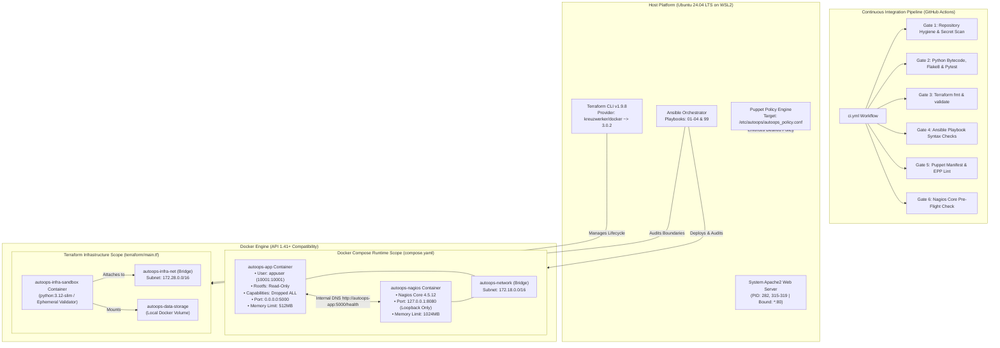

# AutoOps — Comprehensive System Architecture Specification

## 1. Architectural Philosophy & Design Principles

The **AutoOps** platform demonstrates an enterprise-grade, local-first DevOps ecosystem designed to eliminate state collisions, enforce resource isolation, and guarantee reproducible delivery without incurring cloud costs.

Key architectural pillars:
1. **Strict Resource Partitioning**: Zero overlap in lifecycle ownership between Docker Compose, Terraform, Puppet, and Ansible.
2. **Defense in Depth**: Non-root execution, immutable filesystems (`read_only: true`), Linux capability dropping (`cap_drop: [ALL]`), and loopback-only service binding for administrative interfaces.
3. **Continuous Observability**: Dedicated synthetic monitoring via Nagios Core polling intra-container health contracts over an isolated Docker bridge network.
4. **Idempotent State Management**: Declarative desired-state enforcement via Puppet (host-level policy) and Terraform (auxiliary Docker infrastructure).
5. **Decoupled Quality Gates**: Strict separation between ephemeral, non-destructive CI validation (GitHub Actions) and stateful local integration runs.

---

## 2. High-Level Architectural Topology

---

## 3. Component Responsibility Matrix

| Component | Technology | Primary Responsibility | Isolation Boundary |
| :--- | :--- | :--- | :--- |
| **Application Microservice** | FastAPI / Uvicorn (Python 3.12) | High-performance JSON health and status endpoint | Containerized non-root user `appuser` (UID 10001), read-only rootfs, dropped capabilities |
| **Service Orchestrator** | Docker Compose v2.40+ | Local container lifecycle, dependency management, health waiting loops | Manages `autoops-app`, `autoops-nagios`, and `autoops-network` exclusively |
| **Infrastructure as Code** | Terraform v1.9.8 (`kreuzwerker/docker`) | Declarative provisioning of auxiliary audit network, persistent backup volume, and test container | Manages `autoops-infra-net`, `autoops-data-storage`, and `autoops-infra-sandbox` |
| **Configuration Management** | Puppet 8.4 | Desired-state policy enforcement and automated drift remediation | Manages `/etc/autoops/autoops_policy.conf` on the host |
| **Operational Orchestration** | Ansible Core 2.16 | Procedural deployment execution, preflight auditing, smoke testing, and error handling | Orchestrates Compose and verifies system state without claiming IaC state |
| **Synthetic Monitoring** | Nagios Core 4.5.12 | Continuous health polling, failure detection, and automatic recovery verification | Attached to `autoops-network`, queries `/health`, web UI bound strictly to `127.0.0.1:8080` |
| **Continuous Integration** | GitHub Actions (`ci.yml`) | Automated static analysis, linting, unit testing, and schema validation on git push/PR | Ephemeral runner; purely non-destructive with zero state modification |

---

## 4. Network and Storage Architecture

### A. Network Isolation & Port Segregation
1. **Host Apache Protection**: The host machine runs an active Apache2 server listening on `*:80`. To avoid port collisions, AutoOps strictly avoids host port 80.
2. **Application Network (`autoops-network`)**: Subnet `172.18.0.0/16`. Used for internal inter-container communication. Docker embedded DNS resolves `http://autoops-app:5000/health` directly for Nagios probes.
3. **Infrastructure Audit Network (`autoops-infra-net`)**: Subnet `172.28.0.0/16`. Maintained by Terraform as an isolated management network completely distinct from the runtime application network.
4. **Localhost Dashboard Binding**: `autoops-nagios` maps container port 80 to host port `127.0.0.1:8080` (loopback only), preventing unauthorized exposure to the external network.

### B. Storage & Volume Partitioning
1. **Container Ephemeral Storage**: `autoops-app` runs with an immutable root filesystem (`read_only: true`) and mounts a volatile in-memory temporary filesystem at `/tmp` (`tmpfs:rw,noexec,nosuid,size=64m`).
2. **Terraform Volume (`autoops-data-storage`)**: Managed exclusively by Terraform state to store persistent infrastructure logs and backups, isolated from Compose containers.
3. **Configuration Mounts**: Nagios configuration files (`nagios.cfg`, `conf.d/autoops.cfg`) are mounted into `/opt/nagios/etc/` with explicit read-only (`:ro`) flags.
