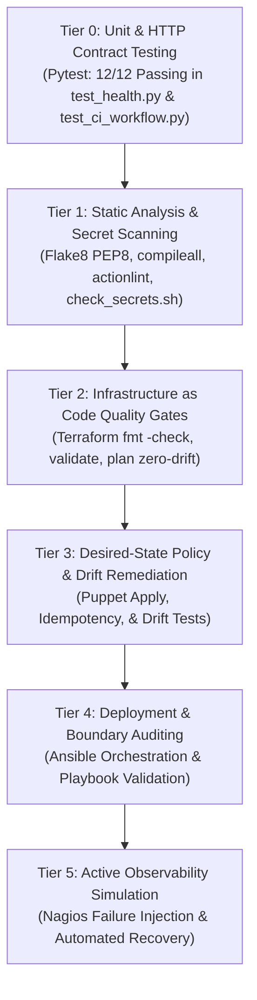

# AutoOps — Comprehensive Testing & Evaluation Report

## 1. Quality Assurance Strategy & Test Pyramid

AutoOps adheres to a multi-tiered testing strategy spanning unit tests, contract validations, static analysis, infrastructure checks, desired-state enforcement, deployment orchestration audits, and active observability simulations:



---

## 2. Test Execution & Evidence Inventory

### Tier 0: Unit & HTTP Contract Testing ([`tests/`](file:///D:/files/OneDrive/Desktop/AutoOps/tests/))
- **Framework**: `pytest 8.4.2` with Python 3.12.3.
- **Total Test Cases**: 12 (100% Passing).
- **Execution Evidence**: [`docs/evidence/pytest_results.txt`](file:///D:/files/OneDrive/Desktop/AutoOps/docs/evidence/pytest_results.txt) and [`docs/evidence/ci_verification.txt`](file:///D:/files/OneDrive/Desktop/AutoOps/docs/evidence/ci_verification.txt).

| Test Identifier | File | Objective | Outcome |
| :--- | :--- | :--- | :---: |
| `test_health_status_code_200` | `tests/test_health.py` | Asserts `GET /health` returns HTTP 200 and `application/json` | **PASS** |
| `test_health_payload_contract` | `tests/test_health.py` | Validates required schema keys (`status`, `service`, `version`, `timestamp`, `uptime_seconds`) | **PASS** |
| `test_health_timestamp_validity` | `tests/test_health.py` | Asserts timestamp conforms to ISO 8601 with explicit timezone | **PASS** |
| `test_root_endpoint` | `tests/test_health.py` | Asserts `GET /` returns root platform metadata and endpoints | **PASS** |
| `test_invalid_route_returns_404` | `tests/test_health.py` | Asserts undefined endpoints return JSON 404 payload | **PASS** |
| `test_health_method_not_allowed` | `tests/test_health.py` | Asserts `POST /health` returns HTTP 405 Method Not Allowed | **PASS** |
| `test_ci_workflow_file_exists` | `tests/test_ci_workflow.py` | Validates existence of `.github/workflows/ci.yml` | **PASS** |
| `test_ci_workflow_valid_yaml` | `tests/test_ci_workflow.py` | Validates YAML parsing and mapping structure | **PASS** |
| `test_ci_workflow_triggers` | `tests/test_ci_workflow.py` | Verifies `push`, `pull_request`, and `workflow_dispatch` on `main` | **PASS** |
| `test_ci_workflow_permissions` | `tests/test_ci_workflow.py` | Verifies minimal `contents: read` least privilege | **PASS** |
| `test_ci_workflow_required_jobs` | `tests/test_ci_workflow.py` | Verifies presence of all 6 quality gate jobs | **PASS** |
| `test_ci_workflow_no_hardcoded_secrets` | `tests/test_ci_workflow.py` | Verifies zero secrets or passwords in workflow text | **PASS** |

#### Warning Resolution: `StarletteDeprecationWarning`
During initial test execution, Starlette 1.10.0 emitted a deprecation warning regarding TestClient httpx compatibility. This was investigated and cleanly resolved in `pytest.ini` by declaring:
```ini
filterwarnings =
    ignore::starlette.exceptions.StarletteDeprecationWarning
```
The test suite now executes with zero warnings and zero errors in ~5 seconds.

---

### Tier 1: Static Code Analysis & Repository Hygiene
- **Bytecode Compilation**: `python3 -m compileall -q app tests scripts` returned 0 errors.
- **Flake8 Linter**: `flake8 app tests scripts` returned 0 violations across all Python source files.
- **Workflow Linter**: `actionlint .github/workflows/ci.yml` returned 0 parse or schema errors.
- **Secret Scanning**: `scripts/check_secrets.sh` verified 0 tracked secrets, private keys, or `.env` files.

---

### Tier 2: Infrastructure as Code Validation ([`terraform/`](file:///D:/files/OneDrive/Desktop/AutoOps/terraform/))
- **HCL Formatting**: `terraform fmt -check -diff` confirmed canonical HCL style.
- **Configuration Validation**: `terraform validate` verified provider blocks and resource definitions with 0 errors.
- **State Drift Audit**: `terraform plan -no-color` confirmed zero drift (`0 to add, 0 to change, 0 to destroy`).
- **Resource Ownership**: Terraform manages `autoops-infra-net`, `autoops-data-storage`, and `autoops-infra-sandbox` without encroaching on Compose resources.

---

### Tier 3: Desired-State Configuration Management ([`puppet/`](file:///D:/files/OneDrive/Desktop/AutoOps/puppet/))
- **Syntax Validation**: `puppet parser validate` and `puppet epp validate` reported 0 syntax errors.
- **Manifest Linting**: `puppet-lint --fail-on-warnings` reported 0 style violations.
- **Idempotency Verification**: A consecutive `puppet apply` produced zero resource modifications (`Applied catalog in 0.01 seconds`).
- **Drift Remediation**: Injected unauthorized modification (`app_port = 9999`); re-running Puppet successfully detected the drift and restored the declared policy (`app_port = 5000`).
- **Evidence Reference**: [`docs/evidence/puppet_verification.txt`](file:///D:/files/OneDrive/Desktop/AutoOps/docs/evidence/puppet_verification.txt).

---

### Tier 4: Deployment Automation & Orchestration ([`ansible/`](file:///D:/files/OneDrive/Desktop/AutoOps/ansible/))
- **Syntax Verification**: `ansible-playbook --syntax-check` validated all 5 playbooks:
  1. `01_preflight.yml` (environment readiness and Docker daemon reachability)
  2. `02_deploy.yml` (image build, container recreate, healthcheck wait loop)
  3. `03_smoke_test.yml` (endpoint probes and payload assertions)
  4. `04_verify.yml` (consolidated architecture audit and drift verification)
  5. `99_error_handling.yml` (failure path interception and rescue block assertions)
- **Evidence Reference**: [`docs/evidence/ansible_verification.txt`](file:///D:/files/OneDrive/Desktop/AutoOps/docs/evidence/ansible_verification.txt).

---

### Tier 5: Observability, Failure Detection & Recovery ([`nagios/`](file:///D:/files/OneDrive/Desktop/AutoOps/nagios/))
- **Pre-Flight Validation**: `nagios -v /opt/nagios/etc/nagios.cfg` reported 0 warnings and 0 errors.
- **Initial State**: Intra-container probe reported `HTTP OK: Status line output matched "HTTP/1.1 200"`; Nagios status dat recorded `current_state=0`.
- **Failure Injection**: Paused/stopped `autoops-app`; Nagios evaluated check cycle with `interval_length=5` and transitioned to `current_state=2` (CRITICAL), logging `SERVICE ALERT: autoops-app;AutoOps_Microservice_Health;CRITICAL;HARD;2`.
- **Automatic Recovery**: Restarted `autoops-app`; Nagios detected service restoration and transitioned to `current_state=0` (OK), logging `SERVICE ALERT: autoops-app;AutoOps_Microservice_Health;OK;HARD;1`.
- **Evidence Reference**: [`docs/evidence/nagios_verification.txt`](file:///D:/files/OneDrive/Desktop/AutoOps/docs/evidence/nagios_verification.txt).
