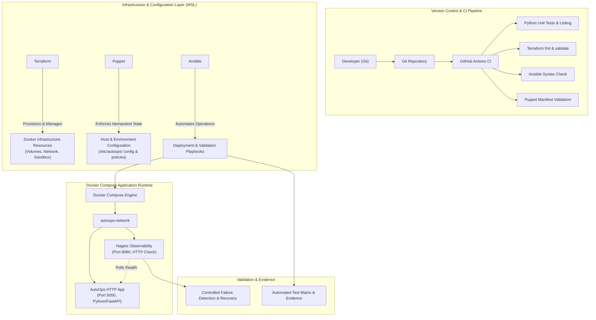

# Milestone 00 — Environment Diagnostic Report & Architecture Lock

**Project:** AutoOps — CI/CD, Infrastructure as Code & Observability Platform  
**Date:** 2026-10-27  
**Status:** Completed & Verified  

---

## 1. Executive Summary

A comprehensive environment inspection was conducted across both the Windows 11 host and the Ubuntu 24.04 WSL2 virtual environment. The workspace directory `D:\files\OneDrive\Desktop\AutoOps` (`/mnt/d/files/OneDrive/Desktop/AutoOps`) is currently empty and unpolluted. Hardware resources (16 GB RAM, 8 vCPUs, >950 GB free disk space in WSL) are more than sufficient.

Key findings include:
- **WSL2** is running **Ubuntu 24.04.5 LTS** with **systemd** enabled as PID 1.
- **Python 3.12.3**, **Ruby 3.2.3**, **Git 2.43.0**, **Make**, and **Curl** are already installed in Ubuntu WSL.
- **Docker Desktop** is installed on Windows but is currently stopped; the Docker daemon is unreachable via standard named pipes. However, native **`docker.io` (v29.1.3)** and **`docker-compose-v2` (v2.40.3)** are immediately available via Ubuntu’s package repository and can run seamlessly under WSL2’s systemd daemon.
- **Ansible (9.2.0)** and **Puppet (8.4.0)** are available in Ubuntu apt repositories.
- **Terraform** is missing and will be installed via HashiCorp's official Linux binary.
- Port 80 is occupied in WSL by an existing Apache2 instance; therefore, AutoOps services will use non-conflicting dedicated ports (**5000** for the Python HTTP application and **8080** for Nagios).

---

## 2. Environment Diagnostic Matrix

| Component | Target / Assumption | Verified Reality | Status | Notes |
| :--- | :--- | :--- | :--- | :--- |
| **Operating System** | Ubuntu 24.04 via WSL | Ubuntu 24.04.5 LTS (`6.18.54.1-microsoft-standard-WSL2`) | **VERIFIED** | Systemd is active as PID 1 |
| **Workspace** | Local repo | `D:\files\OneDrive\Desktop\AutoOps` (`/mnt/d/...`) | **VERIFIED** | Clean, empty directory |
| **CPU Resources** | Multi-core x86_64 | 8 vCPUs | **VERIFIED** | Excellent capacity |
| **Memory (RAM)** | 16 GB | 7.6 GiB allocated to WSL (6.3 GiB free, 7.0 GiB available), 2.0 GiB swap | **VERIFIED** | Sufficient for local containers |
| **Disk Space** | Sufficient | Root `/`: 954 GB free; Host `D:\`: 50 GB free | **VERIFIED** | No storage bottlenecks |
| **Python** | Python 3.x | Python 3.12.3 in WSL (`/usr/bin/python3`) | **VERIFIED** | `python3-venv` and `python3-pip` need installation |
| **Ruby** | For Puppet tooling | Ruby 3.2.3 in WSL (`/usr/bin/ruby`) | **VERIFIED** | Ready |
| **Git** | Modern Git | Git 2.43.0 in WSL; Git 2.54.0 on Windows host | **VERIFIED** | Ready |
| **Docker Engine** | Docker daemon active | Docker Desktop stopped; daemon inactive | **ACTION REQUIRED** | Use native WSL `docker.io` service with systemd |
| **Docker Compose** | Compose v2 | `docker-compose-v2` available via apt | **ACTION REQUIRED** | Install via apt alongside `docker.io` |
| **Terraform** | IaC for Docker | Not installed | **ACTION REQUIRED** | Install official HashiCorp binary |
| **Ansible** | Deployment automation | Not installed; candidate 9.2.0 in apt | **ACTION REQUIRED** | Install via apt |
| **Puppet** | Config management | Not installed; candidate 8.4.0 in apt | **ACTION REQUIRED** | Install via apt |
| **Network & Ports** | Free ports | Port 80 used by Apache2; Ports 5000 and 8080 free | **VERIFIED** | Assign 5000 (App) and 8080 (Nagios) |

---

## 3. Compatibility Risks & Mitigations

1. **Docker Daemon Access (Windows Docker Desktop vs. Native WSL2 Docker)**
   - *Risk:* Docker Desktop requires Windows GUI startup, background service synchronization, and often exhibits named-pipe or credential helper timeouts in headless terminal environments.
   - *Mitigation:* Because WSL2 on this machine has `systemd` enabled, we can install native `docker.io` directly in Ubuntu 24.04. `dockerd` runs natively as a systemd service (`systemctl enable --now docker`), providing instantaneous socket access (`/var/run/docker.sock`) to Terraform, Ansible, and Docker Compose without Windows IPC overhead.

2. **IPv6 vs. IPv4 DNS Delay in WSL2**
   - *Risk:* Dual-stack DNS lookups in WSL2 on university/enterprise networks can cause 30-second timeouts if IPv6 has no default route.
   - *Mitigation:* We verified that setting `Acquire::ForceIPv4 "true";` in `/etc/apt/apt.conf.d/99force-ipv4` permanently eliminates any apt stalls.

3. **Port Conflicts**
   - *Risk:* Local port 80 is actively bound to Apache2 in WSL.
   - *Mitigation:* Bind the AutoOps application to `5000` (host port 5000: container port 5000) and Nagios to `8080` (host port 8080: container port 80).

4. **Resource Ownership Isolation (Terraform vs. Docker Compose)**
   - *Risk:* If Terraform and Docker Compose manage the same container instance, race conditions and state corruption occur.
   - *Mitigation:* Clear boundary enforcement:
     - **Docker Compose** exclusively manages application runtime containers (`autoops-app` and `autoops-nagios`) and the primary network (`autoops-net`).
     - **Terraform** manages auxiliary infrastructure resources (e.g. `autoops-infra-volume`, dedicated Docker logging/isolated network, or an automated ephemeral sandbox environment `autoops-iac-sandbox`).

---

## 4. Final Architecture Decision

---

## 5. Minimal Dependency Installation Plan

To prepare the environment for Milestone 01 through Milestone 04, the following targeted packages will be installed inside Ubuntu WSL:

1. **Python Virtual Environment & Package Tools**:
   - `python3-venv`, `python3-pip` (Ubuntu apt)
   - Reason: Required to isolate Python dependencies (`pytest`, `httpx`, `fastapi`/`flask`, `flake8`) for the application.

2. **Docker Engine & Compose Plugin**:
   - `docker.io`, `docker-compose-v2` (Ubuntu apt)
   - User `shari` added to `docker` group.
   - Reason: Provides the native Docker daemon and compose runtime under WSL2 systemd.

3. **Terraform CLI**:
   - HashiCorp Terraform 1.9+ Linux binary placed in `/usr/local/bin/terraform`.
   - Reason: Required for Infrastructure as Code formatting, validation, and Docker resource orchestration.

4. **Ansible**:
   - `ansible` (Ubuntu apt, v9.2.0 / ansible-core 2.16)
   - Reason: Required for operational playbooks and deployment automation.

5. **Puppet**:
   - `puppet` (Ubuntu apt, v8.4.0)
   - Reason: Required for configuration management and manifest validation.
